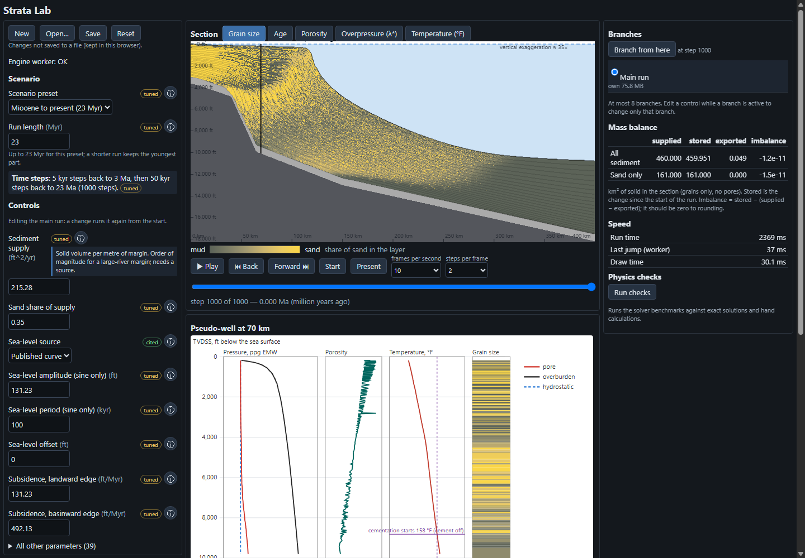

# Strata Lab

Watch a deepwater basin build itself. You set the conditions (sea level, sediment supply,
subsidence, rock properties) and the physics does the rest: clinoforms build out, sand bypasses
to the basin floor at lowstand, and mud that is buried fast stays overpressured. You can rewind
to any moment and branch a what-if.

It runs in the browser from one offline HTML file. Nothing is sent anywhere.



## Status

Early, and built in the open. The foundation (milestone M1) is on `main`: a 2D section with sediment
transport, turbidity currents, subsidence, compaction coupled to pore pressure, burial temperature
and quartz cement, a published sea-level curve, rewind, branches, and save/open. Slope failure and
mass-transport deposits (M2) are on `main` too (off by default; try the *Overpressured slope
(MTD-prone)* preset). Salt (M3) is next. See [`docs/roadmap.md`](docs/roadmap.md).

**This is a learning and exploration tool.** It is not calibrated to any real basin and must not be
used for operational well design or pore-pressure prediction.

## Try it

You need [Node.js](https://nodejs.org/) 22 or newer and git.

```sh
git clone https://github.com/Pepepancakes/strata-lab.git
cd strata-lab
npm ci
npm run build
```

Then open `dist/strata-lab.html` in Chrome or Edge, the browsers it is tested in (double-click
it; it works from `file://`, offline). The default run (last 3 Myr) starts on load and takes about 2 seconds.
[`docs/user-guide.md`](docs/user-guide.md) explains every control.

For development with hot reload, run `npm run dev` instead.

**No Node?** The two early prototypes are committed as ready-built single files. Download and open
`spikes/001-shelf-to-basin/dist/strata-spike-001.html` (shelf to basin) or
`spikes/002-salt/dist/strata-spike-002.html` (salt under a prograding wedge).

## What it does

- **Three run lengths:** last 3 Myr (default), Miocene to present (23 Myr) and the full Cenozoic
  (66 Myr), with coarser time steps further back so long runs still take a few seconds.
- **Sea level** from a published curve (Bintanja & van de Wal 2008 spliced to Miller et al. 2020),
  or a sine you control.
- **Section views** coloured by grain size, age, porosity, overpressure or temperature, with a
  time bar to scrub, play and rewind.
- **Pseudo-well** at any position: pore pressure, overburden and hydrostatic in ppg EMW, porosity,
  temperature and grain size against depth in feet.
- **Branches:** fork a what-if from any moment and compare it with the main run.
- **Honesty panels:** a per-grain-size mass balance, and a physics-checks panel that runs the
  solvers against exact solutions and hand calculations in the browser. Every parameter is
  labelled *cited* (with its source) or *tuned*.
- **Scenario files:** save and reopen a run as a small `*.strata.json` recipe; the app also
  autosaves to the browser.

## Principles

1. **Physics honesty.** Mass is conserved per grain size, every solver is benchmarked against an
   exact solution or a hand calculation (for example Gibson 1958 for consolidation), and every
   parameter is cited in [`docs/physics-references.md`](docs/physics-references.md) or labelled
   tuned.
2. **Deterministic.** Same inputs, same results, bit for bit, on a given machine and browser.
   Rewind and branches depend on it.
3. **One stratigraphic record, many views.** The engine's layer record is the only source of
   truth; every view reads it.
4. **Offline and local.** No runtime network requests.
5. **Synthetic or published data only.** No company, well, lease or seismic data, ever.

## Known issues

- **CI on Linux is red.** All checks pass on Windows. On the GitHub Linux runner the golden-output
  and stored-hash tests fail, because floating-point results are not bit-identical across
  operating systems and the threshold logic amplifies the difference; several timed tests also
  exceed their limits on the slower runner. Same inputs give the same result on one machine, not
  across machines. The fix is decided: cross-machine tests will compare with tolerances and
  summary statistics, while exact equality stays the rule on one machine
  ([`docs/decisions.md`](docs/decisions.md), D14 and D16).
- More limits are listed in section 13 of the user guide.

## Development

| Command | What it does |
|---|---|
| `npm run check` | Typecheck, lint and all tests (what CI runs) |
| `npm run build` | Writes the single offline file `dist/strata-lab.html` |
| `npm run check:offline` | Fails if the built file contains any remote URL or network call |
| `npm run verify:built` | Opens the built file in headless Chrome/Edge and checks it starts cleanly |
| `node spikes/001-shelf-to-basin/test.js` | Runs the prototype's physics checks (ends `ALL PASS`) |

Stack: TypeScript, React, Vite, Vitest. The physics engine is pure TypeScript in `src/engine/` and
runs in a Web Worker.

## Docs

| File | For |
|---|---|
| [`docs/user-guide.md`](docs/user-guide.md) | Using the app: every control, view and panel |
| [`docs/physics-references.md`](docs/physics-references.md) | The source of every equation and parameter |
| [`PROJECT.md`](PROJECT.md) | What this is, why, and what it is not |
| [`docs/roadmap.md`](docs/roadmap.md) | Milestones and what is next |
| [`docs/decisions.md`](docs/decisions.md) | Decisions and the reasons for them |
| [`docs/agent-guide.md`](docs/agent-guide.md) | Rules and layout for anyone (or any AI agent) changing the code |
| [`docs/handover.md`](docs/handover.md) | Known traps and how to pick the project up |
| [`CONTRIBUTING.md`](CONTRIBUTING.md) | Issues and pull requests |

Much of the code is written by AI coding agents working under the rules in the agent guide, and
checked by tests, benchmarks and integrity reviews (`docs/reviews/`).

## Licence

Code: [MIT](LICENSE). The bundled sea-level data sets carry their own licences (CC0 1.0 and
CC BY 4.0) and must be cited; see [`NOTICE.md`](NOTICE.md).
